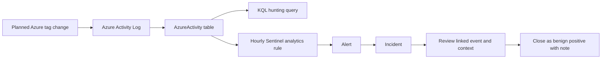
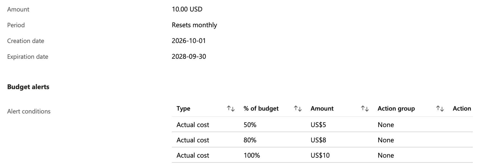
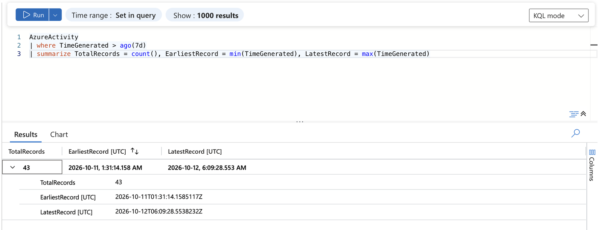
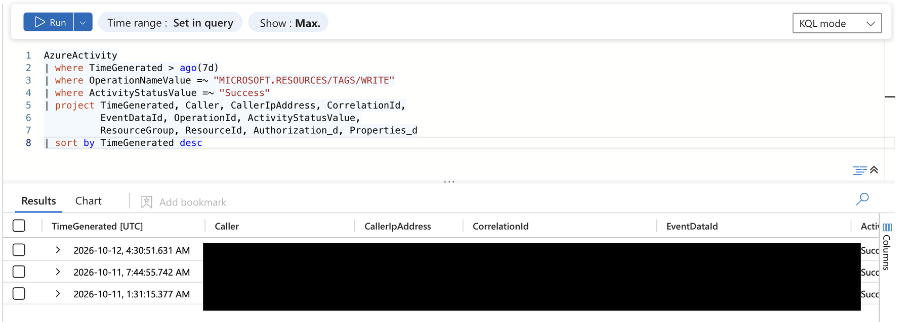
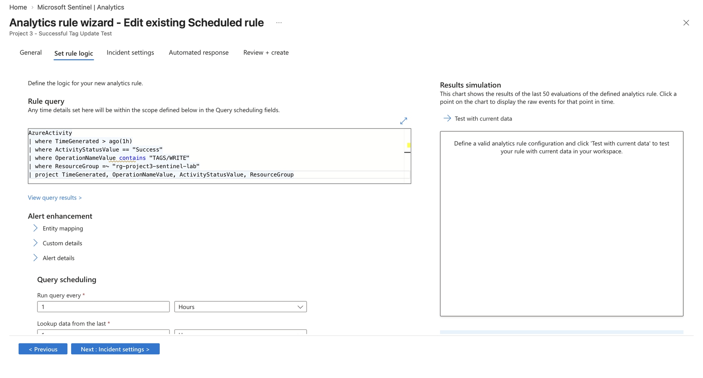
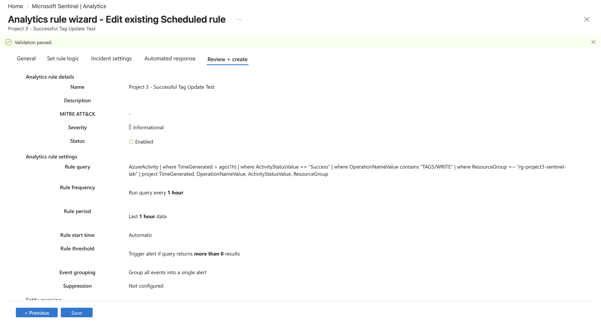
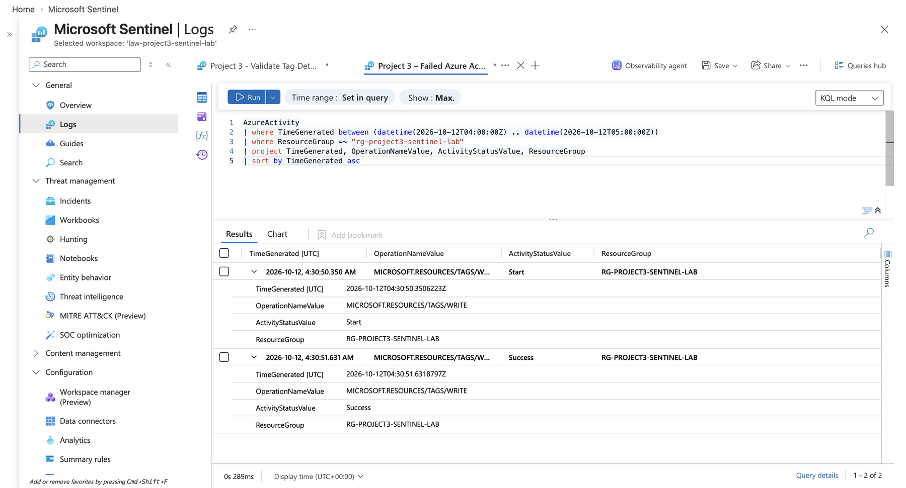

# Azure Activity Log Detection and Incident Triage Lab

**Microsoft Sentinel · Azure Activity Logs · Kusto Query Language (KQL)**

Oluwaseyi Michael Falode | Cloud Security Portfolio | October 2026


This project follows a controlled Azure resource-tag change from the Azure Activity Log to a Microsoft Sentinel alert, incident review, and documented analyst decision. I used KQL to confirm that the data was arriving, find successful tag writes, and reconstruct the event timeline. The enabled scheduled rule generated alerts for two planned lab actions; I reviewed both resulting incidents and closed them as **Benign Positive - Suspicious but expected**.

> **Scope:** This was a benign monitoring test in my own lab. It did not involve a real attack, containment, or recovery. The role-assignment and resource-deletion queries are proposed detection candidates; I did not deploy or test them.

## Contents

- [Project at a glance](#project-at-a-glance)
- [Why this project](#why-this-project)
- [Monitoring flow](#monitoring-flow)
- [Investigation walkthrough](#investigation-walkthrough)
- [Results](#results)
- [Evidence index](#evidence-index)
- [KQL query library](#kql-query-library)
- [Reproduction notes](#reproduction-notes)
- [Repository structure](#repository-structure)
- [Lessons and limitations](#lessons-and-limitations)
- [Skills demonstrated](#skills-demonstrated)
- [References](#references)

## Project at a glance

| Area | Details |
|---|---|
| Cloud platform | Microsoft Azure |
| SIEM | Microsoft Sentinel connected to a Log Analytics workspace |
| Data source | Azure Activity Log in the `AzureActivity` table |
| Query language | Kusto Query Language (KQL) |
| Detection | Successful tag writes scoped to the lab resource group |
| Rule schedule | Every 1 hour; query period 1 hour; alert when results are greater than 0 |
| Severity | Informational |
| Lab region | Canada Central |
| Cost guardrail | USD 10 monthly budget with 50%, 80%, and 100% thresholds |
| Evidence | 13 redacted portal screenshots plus the illustrated PDF walkthrough |

## Why this project

Azure management actions can change the configuration and ownership context of cloud resources. A security analyst needs a way to find a relevant action, identify what happened, connect it to an alert and case, and explain whether the activity was expected. This lab demonstrates that investigation workflow using a low-risk tag change.

## Monitoring flow



## Investigation walkthrough

### 1. Set up an isolated, cost-aware lab

I used a dedicated resource group (`rg-project3-sentinel-lab`) and Log Analytics workspace (`law-project3-sentinel-lab`) in Canada Central, with Microsoft Sentinel enabled. I created a USD 10 monthly budget and thresholds at 50%, 80%, and 100%.

The budget is a warning mechanism, not a spending cap. The saved budget screen shows **Action group: None**, so email or other notification delivery is not demonstrated.



### 2. Check data availability before hunting

I queried `AzureActivity` over the previous seven days and summarized the record count and time boundaries. The workspace contained **43 records**, from **2026-10-11 01:31:14 UTC** to **2026-10-12 06:09:28 UTC**. Although the query requested seven days, the new workspace held about **28 hours 38 minutes** of activity. That coverage limit matters when interpreting a query that returns no rows.

Query: [`01-azure-activity-coverage.kql`](queries/01-azure-activity-coverage.kql)



### 3. Find successful tag writes

The hunting query filters the activity table to the tag-write operation and successful results. It returns actor, IP, event and correlation identifiers, resource, and authorization context so an analyst can investigate the event instead of treating a match as a verdict.

The query returned **three successful tag writes**:

| Time (UTC) | Project finding |
|---|---|
| 2026-10-11 01:31:15.377 | No incident is shown for this row; the activity is not attributed in this report. |
| 2026-10-11 07:44:55.742 | Planned lab test; linked to Incident 1. |
| 2026-10-12 04:30:51.631 | Planned lab test; linked to Incident 2. |

The workspace returned an email-style value in the `Caller` field. I treated it cautiously and did not use it alone to attribute an action to a person. An IP address is also a lead for investigation, not proof of identity. Identifiers are covered in this public evidence set.

Query: [`02-tag-change-investigator.kql`](queries/02-tag-change-investigator.kql)



### 4. Configure a narrow scheduled detection

I created and enabled **Project 3 - Successful Tag Update Test**. The rule asks whether a successful tag write occurred in the lab resource group in the last hour. Its one-hour schedule is suitable for a basic pipeline test, though it can mean a noticeable delay before an alert appears.

| Setting | Value |
|---|---|
| Operation | `MICROSOFT.RESOURCES/TAGS/WRITE` |
| Resource scope | `rg-project3-sentinel-lab` |
| Schedule and period | Every 1 hour; last 1 hour |
| Threshold | More than 0 query results |
| Severity | Informational |
| Event grouping | All matching events into one alert |
| Entity mapping | None configured |
| Validation | Passed; rule enabled |

The exact query configured in the deployed rule is [`00-deployed-tag-rule.kql`](queries/00-deployed-tag-rule.kql). The broader hunting query and the specific test-window timeline are [`02-tag-change-investigator.kql`](queries/02-tag-change-investigator.kql) and [`03-tag-event-timeline.kql`](queries/03-tag-event-timeline.kql).





### 5. Reconstruct the October 12 operation

I narrowed the log to **04:00–05:00 UTC** on October 12 and ordered the matching resource-group records by time. The results show an operation starting at **04:30:50.350 UTC**, then succeeding at **04:30:51.631 UTC**, about 1.28 seconds later. These are two stages of one tag change, not two separate edits.

Query: [`03-tag-event-timeline.kql`](queries/03-tag-event-timeline.kql)



### 6. Link alerts to incidents and record the decision

The scheduled rule generated one alert and one incident for each of the two planned tests. The test events occurred about 21 hours apart, so these are separate investigations rather than duplicate incidents for one event. The event, alert record, incident detail, and incident activity are shown in the numbered screenshots below and in the PDF.

I reviewed the linked Azure Activity event and confirmed it matched my expected lab tag change. I found no sign of an unauthorized change and closed each incident as **Benign Positive - Suspicious but expected**. The rule correctly detected the behavior it was designed to find; the investigation context showed that the behavior was authorized. No containment was needed.

The incidents had no mapped entities, so Sentinel did not provide an account or IP entity for graph-based pivots. Entity mapping is a future improvement, not a demonstrated capability of this rule.

## Results

| Demonstrated | Not demonstrated |
|---|---|
| AzureActivity coverage query and 43-record result | Real malicious activity |
| Three successful tag-write records found with KQL | Containment or recovery |
| Enabled scheduled analytics rule with validation passed | Automated response |
| Two alerts and two incidents tied to planned test events | Role-assignment detection deployed and tested |
| Event timeline distinguishes operation start from success | Resource-deletion detection tested on a disposable resource |
| Both incidents reviewed and closed with written rationale | Budget alert notification delivery |

### Alert timing

The first alert was generated at **08:41:59 UTC**, about 57 minutes after its event at 07:44:55 UTC. The second alert was generated at **04:41:57 UTC**, about 11 minutes after its event at 04:30:51 UTC. The difference is consistent with an hourly schedule: alert delay depends on when an event lands relative to a rule run.

The incident portal displayed local Toronto time (UTC-4), while Logs displayed UTC. The walkthrough normalizes the timeline to UTC to make the sequence easier to compare.

## Evidence index

All screenshots below are extracted from the supplied Azure portal evidence in the walkthrough. Account and event identifiers have been covered with solid black redactions. The images are not recreated or simulated.

| Screenshot | What it shows |
|---|---|
| [01 - Budget guardrails](screenshots/01-budget-guardrails.png) | Monthly budget and threshold configuration; no action group shown. |
| [02 - Activity coverage](screenshots/02-activity-coverage.png) | Query and 43-record time coverage result. |
| [03 - Successful tag writes](screenshots/03-successful-tag-writes.png) | Three matching successful tag-write rows, with identifiers redacted. |
| [04 - Rule query and scheduling](screenshots/04-rule-query-scheduling.png) | Analytics rule query and schedule setup. |
| [05 - Enabled rule settings](screenshots/05-rule-settings-enabled.png) | Saved rule status, severity, schedule, threshold, and validation. |
| [06 - October 12 timeline](screenshots/06-october-12-timeline.png) | Start and Success stages of the planned test event. |
| [07 - Closed incidents](screenshots/07-closed-incidents.png) | Both Project 3 incidents and their closed status. |
| [08 - Incident 1 linked event](screenshots/08-incident-1-linked-event.png) | Azure event connected to the first incident. |
| [09 - Incident 1 alert](screenshots/09-incident-1-alert.png) | Alert record behind the first incident. |
| [10 - Incident 1 closure note](screenshots/10-incident-1-closure-note.png) | Incident activity, closure rationale, and analyst note. |
| [11 - Incident 2 overview](screenshots/11-incident-2-overview.png) | Second incident detail and closing note. |
| [12 - Incident 2 linked event](screenshots/12-incident-2-linked-event.png) | Azure event connected to the second incident. |
| [13 - Incident 2 alert](screenshots/13-incident-2-alert.png) | Alert record behind the second incident. |

The complete, captioned walkthrough is [Project3_Azure_Activity_Sentinel_Portfolio.pdf](docs/Project3_Azure_Activity_Sentinel_Portfolio.pdf).

## KQL query library

| File | Purpose | Status |
|---|---|---|
| [`01-azure-activity-coverage.kql`](queries/01-azure-activity-coverage.kql) | Count records and inspect actual time coverage. | Run in the lab; result shown in Evidence 02. |
| [`00-deployed-tag-rule.kql`](queries/00-deployed-tag-rule.kql) | Exact KQL configured in the enabled hourly tag-write rule. | Deployed; settings shown in Evidence 04 and 05. |
| [`02-tag-change-investigator.kql`](queries/02-tag-change-investigator.kql) | Find successful tag writes and fields for investigation. | Run in the lab; result shown in Evidence 03. |
| [`03-tag-event-timeline.kql`](queries/03-tag-event-timeline.kql) | Reconstruct the October 12 test window. | Run in the lab; output shown in Evidence 06. |
| [`04-detect-role-assignment-writes.kql`](queries/04-detect-role-assignment-writes.kql) | Candidate query for successful role-assignment writes. | Proposed; not deployed or tested. |
| [`05-detect-high-impact-resource-deletions.kql`](queries/05-detect-high-impact-resource-deletions.kql) | Candidate query for selected Azure resource deletions. | Proposed; not deployed or tested. |
| [`06-failed-azure-actions.kql`](queries/06-failed-azure-actions.kql) | Review terminal failures with exact `Failure` status. | Companion query; not a headline result. |
| [`07-investigate-older-tag-writes.kql`](queries/07-investigate-older-tag-writes.kql) | Inspect the earlier tag-write rows and test their resource context. | Investigation query; attribution remains open. |

### KQL in plain language

KQL reads a table as a stream of rows. Each `|` sends the current rows to the next operation:

```kusto
AzureActivity
| where TimeGenerated > ago(7d)
| where OperationNameValue =~ "MICROSOFT.RESOURCES/TAGS/WRITE"
| where ActivityStatusValue =~ "Success"
| project TimeGenerated, Caller, ResourceGroup, ResourceId
| sort by TimeGenerated desc
```

- `AzureActivity` selects the table containing Azure management actions.
- `where` keeps records that match a condition.
- `ago(7d)` means the seven days before the query runs.
- `=~` compares text without case sensitivity.
- `project` selects the columns to show.
- `sort by ... desc` puts the newest matching record first.

## Reproduction notes

These queries require an Azure Log Analytics workspace that receives Azure Activity Log records into an `AzureActivity` table. They do not create Azure resources or generate test events by themselves.

1. In a test subscription, create or select a dedicated Log Analytics workspace and enable Microsoft Sentinel.
2. Confirm that Azure management activity is available in `AzureActivity` before relying on a detection result.
3. Start with `01-azure-activity-coverage.kql` and record the actual date range returned.
4. Run `02-tag-change-investigator.kql` to inspect successful tag-write records.
5. If you have authorization, make a harmless tag change in an isolated test resource group and use `03-tag-event-timeline.kql` to compare the Start and Success records.
6. Configure the rule only after confirming the operation name, table fields, and intended test scope in your workspace.
7. Review each alert with the linked Azure event and document the reason for the final classification.

Use your own approved lab. Do not copy the sample resource group name or run the proposed deletion/role-assignment queries without a scoped, authorized test plan. Query results can contain account names, IP addresses, resource identifiers, and correlation IDs; redact those before sharing.

## Repository structure

```text
.
├── docs/
│   └── Project3_Azure_Activity_Sentinel_Portfolio.pdf
├── evidence/
│   └── README.md
├── queries/
│   ├── 00-deployed-tag-rule.kql
│   ├── 01-azure-activity-coverage.kql
│   ├── 02-tag-change-investigator.kql
│   ├── 03-tag-event-timeline.kql
│   ├── 04-detect-role-assignment-writes.kql
│   ├── 05-detect-high-impact-resource-deletions.kql
│   ├── 06-failed-azure-actions.kql
│   └── 07-investigate-older-tag-writes.kql
├── screenshots/
│   └── 01-...png through 13-...png
└── validation/
    └── README.md
```

## Lessons and limitations

- Data coverage is part of the investigation: the query asked for seven days, but the new workspace contained only about 28 hours.
- Azure Activity Log operations can produce multiple lifecycle records. The Start and Success rows for the October 12 event are stages of the same operation.
- Hourly rules are simple to validate, but alert delay can approach an hour. The schedule should match the operational need.
- An alert is a request to investigate, not a statement that an attack occurred. The alert was valid for the behavior, while the case outcome was benign positive.
- The deployed rule did not map entities. An improved rule should preserve and validate actor, IP, and target fields before configuring entity mapping.
- Only one low-risk behavior was tested. The role-assignment and deletion candidates need separate authorized validation before they can be treated as working detections.
- A budget can notify about spending but does not cap or stop it; notification delivery was not verified in this lab.

## Skills demonstrated

Azure Activity Log analysis, Microsoft Sentinel scheduled analytics rules, KQL filtering and timeline queries, cloud detection testing, alert-to-incident triage, evidence handling, benign-positive classification, and cost-aware lab design.

## References

- [Microsoft Learn: AzureActivity table reference](https://learn.microsoft.com/azure/azure-monitor/reference/tables/azureactivity)
- [Microsoft Learn: Scheduled analytics rules in Microsoft Sentinel](https://learn.microsoft.com/azure/sentinel/scheduled-rules-overview)
- [Microsoft Learn: Microsoft Sentinel pricing and billing](https://learn.microsoft.com/azure/sentinel/billing)
- [Microsoft Learn: Microsoft Sentinel in the Defender portal](https://learn.microsoft.com/azure/sentinel/microsoft-sentinel-defender-portal)
- [MITRE ATT&CK T1098.003: Additional Cloud Roles](https://attack.mitre.org/techniques/T1098/003/)
- [MITRE ATT&CK T1485: Data Destruction](https://attack.mitre.org/techniques/T1485/)
